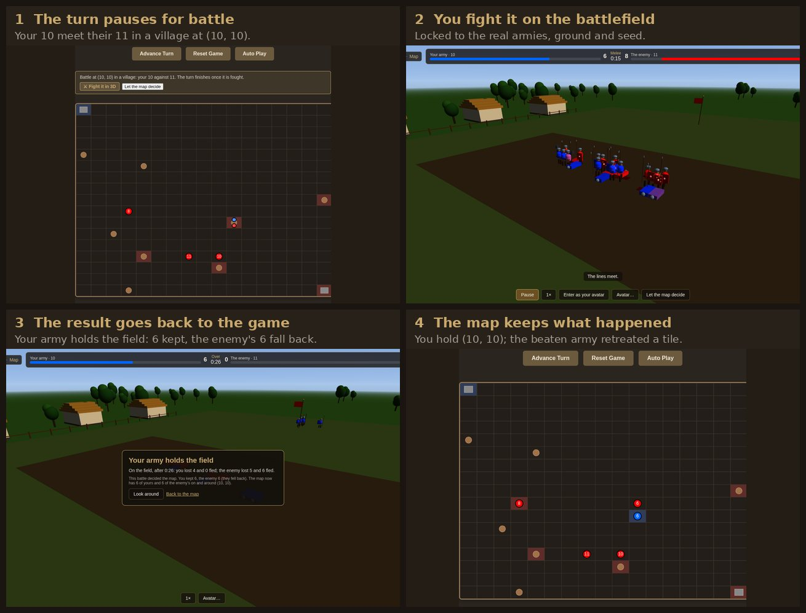

# Barony - Player Guide

**Welcome to Barony!** This guide will teach you everything you need to know to play and win.

## What is Barony?

Barony is a single-player online strategy game where you command armies to capture territory and defeat an AI opponent. Expand your realm by capturing villages, build up your forces, and ultimately capture your enemy's castle to win.

## Quick Start

### Starting the Game

**Using Docker (Recommended):**

Barony uses the [UserAuth](https://github.com/Preponderous-Software/UserAuth) service for
player accounts, which `docker-compose` builds from a sibling checkout. Clone it next to this
repo, set a `JWT_SECRET`, then start everything together:

```bash
git clone https://github.com/Preponderous-Software/UserAuth.git   # next to barony/
cd barony
export JWT_SECRET="please-change-this-to-a-32-byte-minimum-secret"
docker-compose up --build
```
Then open http://localhost:3000 in your browser.

**Manual Start:** (also requires UserAuth running on port 9998 — see its README)
```bash
# Backend (Terminal 1)
cd backend && ./mvnw spring-boot:run

# Web Client (Terminal 2)
cd web-client && ./mvnw spring-boot:run
```
Then open http://localhost:3000 in your browser.

### Creating an Account & Logging In

The first screen offers two ways in: log in to an account, or [play as a guest](#playing-as-a-guest)
without one. New players click **Create one** to register a username (3–50 characters) and password
(at least 8 characters), then log in.

- Your game progress is saved to your account, so you can return to it later.
- Click **Logout** in the game to sign out — this revokes your session immediately.

### Playing as a Guest

Click **Play as guest** on the first screen to start a game with no account. A guest plays the same
game as an account, with these differences:

- **Your game stays in this browser.** It can't be reached from another browser or device, and it
  is deleted after 30 days without play.
- **Your settings stay in this browser too.** Display settings and the sidebar arrangement aren't
  saved to an account, so they don't follow you anywhere.

The game page shows **Guest** as the player, and **Exit guest game** in place of **Logout**. Exiting
keeps your game: the button on the first screen then reads **Continue guest game** and picks up where
you left off.

**Keeping your progress:** a guest game, along with its Run History, can be moved into an account
that has no game yet, which includes any newly created account. Choose **Create a free account** on
the game page (or **Create one** on the first screen), then log in with **Move my guest game into
this account** ticked. The box is ticked for you when you come straight from creating an account.
If the account already has a game, that game is kept, nothing is moved, and your guest game stays in
this browser.

### Game Overview

- **Your Goal:** Capture all enemy castles to win
- **You Control:** Player 1 (Blue armies)
- **Enemy:** Player 2 AI (Red armies)
- **Turn-Based:** Click **Advance Turn** to advance one turn (tick)
- **Starting Forces:** Each side begins with one army of 10 soldiers on its castle

## How to Play

### Understanding the Map

The game board is a grid generated fresh for every game: each side is between 10 and 20 tiles
long, chosen at random, so a map can be anything from 10x10 to 20x20 and need not be square. It
holds different tile types:

- **Castles (Gray)**: 
  - Start at opposite corners: Player 1 at the top-left (0,0), Player 2 at the bottom-right
    corner (which is (9,9) only on a 10x10 map)
  - Blue outline = Player 1 owned
  - Red outline = Player 2 owned
  - Must capture enemy castle to win!

- **Villages (Brown)**:
  - Generate soldiers each turn for their owner's army stationed there: one per 100 population,
    so 1 a turn at the start and more as your villages grow (see **Population** under
    [Understanding Stats](#understanding-stats))
  - Can be captured by occupying with your army
  - Blue tint = Player 1 owned
  - Red tint = Player 2 owned
  - No tint = Neutral (not generating soldiers)

- **Empty Tiles (Green)**:
  - Safe to move through
  - No special effects

**Armies** are circles labelled with their soldier count — blue for yours, red for the enemy's.
Where more than one army stands on a tile (a fresh split, or a fight in progress), the circles are
drawn smaller and spread around the middle of the cell so each one can still be read. Clicking or
hovering picks the circle you are nearest, so on a shared tile you choose between them by aiming at
the one you want rather than getting whichever the game listed first.

### Controlling Your Armies

**Mouse Controls:**
1. **Left-click an army** (blue circle) to select it
   - Selected army will have a glowing highlight
2. **Left-click any tile** to move your selected army there
   - Army will move 1 tile per turn toward the destination, covering the horizontal distance
     first and then the vertical (it never moves diagonally)
   - The destination tile is marked on the map with a dashed outline in your army colour until an
     army arrives there; hover the army to read the coordinates off its tooltip
     (**Moving to: (x, y)**). Only your own armies' destinations are marked.
3. **Right-click** to deselect the army

**Buttons (above the map):**
- **Advance Turn** - Advance the game by one turn
- **Reset Game** - Start a fresh game (also how you play again after a game ends)
- **Auto Play** - Advance a turn automatically every second; click again (**Stop Auto**) to pause.
  Auto Play stops on its own when the game ends.

**Splitting armies:** select an army on the map and use the **Split off** control in the panel
below the map, or use the split control next to any of your armies in the **Armies** panel.

**Keyboard shortcuts** (ignored while typing in a text field, or with Ctrl/Cmd/Alt held):
- **Space** — Advance Turn
- **R** — Reset Game
- **S** — jump to the **Split off** amount box for the selected army
- **A** — toggle Auto Play
- **Escape** — deselect the current army (same as right-click)

**Tip:** Hover over any tile or army to see detailed information. In-game tooltips now cover most of what previously required consulting this guide mid-session.

### Basic Strategy

**1. Capture Villages Early**
- Villages generate soldiers for armies stationed there
- More villages = faster army growth
- Capture neutral villages first (brown with no tint)

**2. Build Up Your Forces**
- Park armies on villages you control
- Each turn, an army on one of your villages gains one soldier per 100 of that village's population
  — 1 at first, more once the village has grown
- Don't attack with weak armies!

**3. Split Your Armies**
- Click one of your armies on the map, then enter an amount in **Split off** and click **Split Army**
- Or use the split control beside that army in the **Armies** panel
- You can split off at most one fewer soldier than the army has (both armies keep at least 1)
- The new army inherits the parent's morale and loyalty — splitting won't reset a disloyal force
- Useful for capturing multiple villages at once
- Can garrison villages while your main force attacks

**4. Friendly Armies Merge**
- Armies at the same location automatically combine, each turn right after armies move
- A split you don't move away rejoins its parent on the next turn, so give the new army a
  destination before you click **Advance Turn**
- The combined army keeps the ID, morale and loyalty of the oldest (lowest-numbered) army; the
  others' morale and loyalty are not averaged in
- If the oldest army had no orders, the combined army takes the destination of one that did
- Use this to consolidate forces before a big battle

**5. Capture the Enemy Castle**
- Must occupy enemy castle for **3 consecutive turns**
- Hover the occupying army to read the running total off its tooltip
- Capture all enemy castles to win!

### Combat

When your armies and the enemy's end up on the same tile, the turn **pauses for battle** right
after the armies move and the AI acts. The game takes you onto the 3D battlefield to fight it out,
with one figure for each soldier (see [Fighting a Battle in 3D](#fighting-a-battle-in-3d)). Nothing
else in that turn happens until the battle is decided: captures, the win check, desertion and
respawns all wait.



**What the battle decides:**
- The side that holds the field keeps the soldiers still standing at the end.
- The side that breaks keeps only the soldiers who ran and got away. It falls back to a
  neighbouring tile, but only onto open ground or its own villages and castles: never onto an enemy
  or neutral village or castle, and never onto a tile with an enemy army. An army with nowhere
  allowed to go is lost. A beaten army also stops marching, so give it new orders.
- If neither side breaks before time runs out, both stay on the tile and fight again next turn.
- Armies with 0 soldiers are destroyed.

**Letting the map decide instead.** Choose **Let the map decide** (above the map, or on the
battlefield), or turn off **Fight battles in 3D** in Settings. The battle is then settled by the
classic rule:
- **Simultaneous damage**: each army loses soldiers equal to the enemy's strength (your strength is
  your soldiers × morale ÷ 100)
- **Example**: 10 soldiers vs 7 soldiers at normal morale → 3 vs 0 (you win with 3 remaining)

**Advance Turn** while a battle is waiting also lets the map decide it, then plays the next turn.

### Fighting a Battle in 3D

The battlefield matches the battle on the map: the same soldiers on each side, your army's morale,
and the ground the armies met on (open field, a village, or before a castle). A larger army is
drawn at one figure per several soldiers, the same scale for both sides, and the tally always counts
in soldiers. Morale decides how hard your side hits and how many losses it takes before it breaks.

- **Watch** from above: drag to look around, and scroll or pinch to zoom. Play at ½×, 1×, 2× or 4×.
- **Take over any soldier** by clicking or tapping it. You see it from behind; press **V** for
  first person.
  - **Keyboard and mouse:** **WASD** to move, **Shift** to run. Click the view to lock the mouse,
    then click (or **Space**) to strike and hold the right button (or **F**) to raise your shield.
    **Esc** frees the mouse, and **Esc** again lets go of the soldier.
  - **Phone:** the stick on the left moves you, dragging the view looks around, and **Strike** and
    **Shield** are on the right.
  - If your soldier falls, tap another to fight on.
- **Enter as your avatar**: your own champion, stronger than a soldier. Choose its name, colours,
  helmet, weapon and shield under **Avatar…**. It is saved with your account (a guest's stays in
  the browser). Your avatar is not one of the army's soldiers, so it does not count toward what the
  army keeps, and it cannot hold the field alone: only soldiers decide who holds the field. Once all
  of a side's soldiers have fallen or fled, that side has lost, even if the avatar still stands.
- When the battle ends, the result goes to your game and **Back to the map** shows it. If the turn
  brought on more than one battle, **Next battle** takes you to the next one.

A battle that is waiting can't be replayed or restarted, and you can't split an army that is in one.
You can also fight practice battles of any size at `/battle` (or **⚔ Practice in 3D** under a
selected army). These change nothing in your game. While the selected army is in a battle waiting
this turn, that link reads **⚔ Fight it in 3D** instead and opens the battle that counts.

**Combat Tips:**
- Attack with superior numbers (at least 1.5x enemy strength)
- Don't waste small armies against fortified positions
- Use split armies to flank and overwhelm

### Village Capture

- **After combat** (once every battle that turn is decided), if only your army remains on a village, you capture it
- **Contested villages** (multiple players present) become neutral
- Villages retain ownership when abandoned (no army present)
- A captured village starts generating soldiers for you on the following turn: each turn,
  soldiers are generated before villages change hands, so the turn you take a village doesn't
  pay out

### Castle Capture

Castles are harder to capture:
1. **Occupy** the enemy castle with your army
2. **Hold** for 3 consecutive turns
3. **Progress resets** if enemy army arrives or you leave
4. **Capture complete** after 3 turns → castle is yours!

A castle being captured shows a progress bar along the bottom of its tile, filled a third per
turn of occupation in the colour of the side doing the capturing — so you can see both your own
sieges and the enemy's at a glance. The exact count is on the tooltip: since a capture under way
always has an army standing on the castle, hover that army and its tooltip ends with
**Capturing castle: 2/3**. A castle nobody is standing on states the hold requirement instead,
because the count resets the moment the tile is left, contested, or held by its own owner. On top
of that, a castle that is the last one its side holds gets a toast every turn the siege on it
advances, counting down the turns remaining.

### Winning and Losing

- **Victory:** Capture all enemy castles
- **Defeat:** Lose all your castles
- Losing every army is not a defeat: at the end of any turn in which a side has no armies left, a
  fresh 1-soldier army appears on one of that side's castles. This applies to the AI too
- A banner appears over the map (**Victory!** or **Defeat**) with a summary of the run: turns
  played, how many castles and villages you finished holding out of the map total, and how many
  armies and soldiers you had left
- Click **Reset Game** (or press **R**) to play again

Along the way, milestones are called out as they happen: capturing or losing a castle raises a
notification with your updated castle count, and once either side is down to its last castle, a
siege on it counts down the turns until it changes hands.

## Advanced Strategy: Ruler Policies

As a ruler, you can enact policies that affect your realm. These provide strategic bonuses but also have trade-offs.

### How to Change Policies

1. Open the **Change Policy** panel in the sidebar
2. Pick an option from the **Economic**, **Military**, or **Population** dropdown
3. Click that category's **Apply** button
4. Wait 15 turns before changing policies again (cooldown — the **Next Decision In** bar in
   **Game Status & Stats** counts it down)

The cooldown is shared by all three categories: changing your Economic policy also locks your
Military and Population policies for the next 15 turns. Re-applying the policy already in force
still counts as a change and restarts the cooldown. Your first change is available from turn 0.

### Policies Take Effect Gradually

A new policy doesn't change your stats at once. It sets a target, and each turn your stats move a
fixed step toward it:

- **Stability** moves 2 points a turn toward 100 plus your Economic and Population modifiers
  (capped at 110), in every village you own
- **Morale** moves 1 point a turn toward 100 plus your Military morale modifier, in every army you
  own
- **Loyalty** moves 2 points a turn toward 100 plus your Military loyalty modifier, in every army
  you own

For example, switching from Standard Service to Aggressive Training takes 10 turns to lift morale
to 110% and 13 turns to bring loyalty down to 75%. New armies start at 100% morale and loyalty
and drift the same way. An army you split off starts at its parent's values instead.

Policies only affect your own villages and armies. The AI's armies always fight at their full
soldier count and never desert, and its villages never grow. An AI army on one of its villages
gains one soldier per 100 of that village's population, whatever the stability. A village keeps
its population when it changes hands, so if the AI captures a village you have grown, it gets
that larger yield.

### Economic Policies

Affect village income and stability:

- **Heavy Taxation**: +20% income, -10% stability
  - More soldiers generated, but villages less stable
  - Good for aggressive expansion

- **Balanced Budget**: No modifiers
  - Default, safe option

- **Infrastructure Investment**: -10% income, +10% stability
  - Slower growth, but villages more stable
  - Good for defensive play

### Military Policies

Affect army morale and loyalty:

- **Aggressive Training**: +10% morale, -25% loyalty
  - Armies fight better, but loyalty settles at 75% and soldiers steadily desert
  - The bigger the army, the more soldiers per turn it loses
  - Good for offensive campaigns — win before the attrition adds up

- **Standard Service**: No modifiers
  - Default, balanced option

- **Veteran Benefits**: -10% morale, +10% loyalty
  - Armies less aggressive, but very loyal (no desertion)
  - Good for long games

### Population Policies

Affect village growth and stability:

- **Growth Focus**: +15% population growth, -5% stability
  - Villages grow faster, slightly less stable
  - Good for early game expansion

- **Stable Population**: No modifiers
  - Default option

- **Quality Over Quantity**: -10% growth, +10% stability
  - Slower growth, more stable villages
  - Good for defensive consolidation

### Understanding Stats

Check **Ruler Stats** in the **Game Status & Stats** panel (in the sidebar) to monitor:

- **Stability** (villages): Affects soldier generation efficiency
  - Generation scales with it — at 100% a village generates its full amount, at 50% half of it
  
- **Morale** (armies): Affects combat effectiveness
  - Your armies fight as though they had `soldiers × morale / 100` soldiers
  - 100% = normal combat strength; above 100% = bonus; below 100% = weaker in combat
  
- **Loyalty** (armies): Affects desertion rate
  - 100% = no desertion, and restoring it to 100% clears any desertion still pending
  - Each turn an army loses `(100 - loyalty) / 20`% of its soldiers
  - Losses under one whole soldier carry over between turns rather than being ignored, so
    even a small army eventually feels a fractional rate
  
- **Population**: Total population across your villages
  - Every village starts at 100; yours grow by about 1% each turn (the Population policies nudge
    the rate), whether or not an army is stationed there. Neutral and enemy-held villages do not grow.
  - A village generates one soldier per turn for every full 100 of its population, so a village
    of 200 generates 2 — before the stability scaling above

Stability, morale and loyalty are all colour-coded the same way: **green at 90 and above**,
**amber from 70 to 89**, and **red below 70**. Aggressive Training's 75% loyalty target therefore
shows amber. Population is reported as a plain total and is not colour-coded.

### Policy Strategy Tips

**Aggressive Strategy:**
- Use Heavy Taxation + Aggressive Training
- Rapid expansion with strong combat bonus
- Switch back to Standard Service to stop desertion once you've taken what you need
- Best for short, decisive games

**Defensive Strategy:**
- Use Infrastructure Investment + Veteran Benefits
- Stable, loyal armies and villages
- Slower growth but very resilient
- Best for longer games

**Balanced Strategy:**
- Keep default policies (Balanced/Standard/Stable)
- No bonuses or penalties
- Safe, predictable gameplay
- Good for learning the game

**Note:** Policy effects take several turns to manifest. Don't expect instant results!

## Reading the Interface

### Controls (above the map)
**Advance Turn**, **Reset Game**, and the **Auto Play** toggle.

While a battle is waiting, a **battle banner** sits between these controls and the map. It says
where the battle is and how many soldiers each side has, and offers **⚔ Fight it in 3D** (opens the
battle on the 3D battlefield) and **Let the map decide** (settles it by the classic rule). The turn
finishes once every waiting battle is decided.

### Selected Army Panel (below the map)
Shows the army you clicked on the map — its ID, soldier count, and position — plus the
**Split off** control and a link to the 3D battlefield. The link reads **⚔ Practice in 3D** and
opens a practice battle against the nearest enemy army, which changes nothing in your game. If the
army is in a battle waiting this turn, it reads **⚔ Fight it in 3D** instead and opens that battle,
the one that decides the map. Until you select one of your armies the panel just prompts you to
click one.

### Game Status & Stats (sidebar)
- **Game Status**: current turn, whether the game is over and the winner once it is, and a
  castle count (yours, the enemy's, and neutral, out of the total on the map)
- **Ruler Stats**: average stability, morale, and loyalty, plus total population
  (color-coded: green ≥ 90, amber 70–89, red < 70)
- **Policies**: the policy in force in each category and a **Next Decision In** cooldown bar

### Run History (sidebar)
Your win/loss tally and a list of your recent finished runs — result, turns played, and castles
and villages held at the end of each. Recorded the moment a run ends, so it survives **Reset
Game** and a server restart; it's the only thing that persists across runs, everything else about
your realm starts fresh each time.

### Armies, Change Policy, and Settings (sidebar)
Three more collapsible panels: the **Armies** list, the policy dropdowns, and the display
settings. Each army in the list shows its ID, owner, position, soldiers, morale, and loyalty, and
your armies with 2+ soldiers get a split control.

### Arranging the sidebar
The panels appear in this order to begin with: Game Status & Stats, Run History, Armies, Change
Policy, Settings. That arrangement is yours to change, from the **Panels** controls in the
Settings panel:

- **Show or hide a panel** with its checkbox — a hidden panel disappears from the sidebar until
  it is checked again. The Settings panel itself can't be hidden, since it holds these controls.
  A hidden panel keeps its place in the list, so checking it again brings it back where you left
  it rather than at the bottom.
- **Reorder the panels** with the ▲ and ▼ buttons beside each name. A shown panel moves past the
  next panel you can see, so every press moves it in the sidebar even when hidden panels sit in
  between; the ▲ or ▼ is greyed out once the panel is at the top or bottom of what is shown. A
  hidden panel moves one place at a time in the list, which is how you position it before showing
  it again.
- **Reset Panel Layout** puts every panel back, in the order above.

Each panel also remembers whether you left it open or collapsed. The whole arrangement — order,
which panels are shown, and which are open — is saved in your browser, so reopening the game
doesn't reset it back to the defaults. While you are signed in it is also saved to your account,
so signing in on another browser or device brings your arrangement with you.

## Accessibility & Visual Settings

### Settings Panel
Open the **Settings** panel in the sidebar. Changes apply immediately:

- **Colorblind Mode:** None (default), Deuteranopia, Protanopia, Tritanopia
  - Applies to faction colors and map ownership indicators
- **Theme:** Dark (default), Classic, High Contrast
- **Font Size:** Small, Medium (default), Large
- **Fight battles in 3D:** on by default. When off, every battle is settled at once by the map's
  classic rule, and any battle already waiting is settled that way straight away. This one is
  kept with your game rather than your browser, and **Reset Game** keeps your choice.
- **Panels:** which sidebar panels are shown and in what order (see
  [Arranging the sidebar](#arranging-the-sidebar) above)

Settings are saved to your browser's `localStorage`, and — while you are signed in — to your
account as well, so they are applied wherever you next sign in. Where the two differ, what your
account holds wins. A setting your account has never held — one you chose before signing in, or
while the server was unreachable — is kept and sent up the next time the game page loads, rather
than being discarded.

### Notifications
Non-blocking toast notifications keep you informed without interrupting gameplay:
- **Info** (gray): Army selected or deselected
- **Success** (green): Castle captured, army split, policy applied
- **Warning** (amber): Policy rejected (still on cooldown), final enemy castle under siege, reset
  failed
- **Danger** (red): Castle lost, your last castle under siege, a command that failed (move, split,
  or policy change)

Toasts auto-dismiss after 4 seconds; red notifications about castles persist until you dismiss
them, so you can't miss one while watching the map.

### Canvas Tooltips
Hover over any tile on the canvas to see:
- Tile type and ownership
- Army stats (soldiers, morale, loyalty, destination) — for the army whose circle you are nearest,
  so both sides of a fight and both halves of a split can be read
- Castle capture progress — on the occupying army while a capture is under way, on the castle
  itself when nobody is standing on it
- Village generation info

### Selection Feedback
- Click an army to select it — a gold highlight ring appears
- Right-click the canvas to deselect
- Clicking another army switches selection
- Where two of your armies share a tile, click the one you want: the nearer circle is selected

## Tips for New Players

1. **Start slow** - Take time to learn the controls
2. **Capture villages first** - They're your economy
3. **Build up before attacking** - Don't rush with weak armies
4. **Use split strategically** - Garrison villages, then push forward
5. **Watch the AI** - Learn from enemy movements
6. **Protect your castle** - Losing it means instant defeat
7. **Try different policies** - Experiment to find your strategy

## Common Questions

**Q: How do I make my army move?**
A: Left-click the army to select it, then left-click where you want it to go. The army moves 1 tile per turn.

**Q: Why isn't my village generating soldiers?**
A: Villages only generate soldiers for armies of the owning player stationed on the village. Neutral villages don't generate anything.

**Q: How do I split an army?**
A: Click the army on the map, enter how many soldiers to split off in the **Split off** box
below the map, and click **Split Army** — or use the same control beside that army in the
**Armies** panel. Both armies must have at least 1 soldier after splitting, so an army needs
at least 2 soldiers to split.

**Q: Can I undo a move?**
A: You can change it at any point before the army arrives. Select the army and click a different
tile to send it there instead, or click the tile it is standing on to cancel the order and keep it
where it is. Steps it has already taken are not undone, and a split can't be reversed except by
bringing the two armies back onto one tile, where they merge.

**Q: The AI seems too hard/easy. Can I adjust difficulty?**
A: Currently there's only one AI difficulty level. Try different policy strategies to make it easier or harder on yourself.

**Q: What happens if I close the game?**
A: Your game is saved to your account automatically. Log back in and you'll pick up
where you left off — it survives closing the browser and server restarts. Use **Reset
Game** if you'd rather start over. A guest game is saved too, but only for this browser: choose
**Continue guest game** on the first screen, within 30 days of your last play.

**Q: The game says my saved game couldn't be read. Is it gone?**
A: No. If something in your saved game is damaged, the game keeps it exactly as it was and shows
you a message instead of quietly starting over. Nothing is saved over it while that message is
up. If you want to play on, choose **Start a fresh game** and confirm: your unreadable save is set
aside first (not deleted), and then a new game begins. The battlefield can still run custom battles
in the meantime and links you back to the map. This works the same way for a guest game: choosing
**Continue guest game** takes you to the same message, and the guest game is kept in this browser
until you choose a fresh start. A guest game that can't be read can't be moved into an account
until then; your finished-run history stays either way. (A guest game is still deleted after 30
days without play, as usual.)

**Q: Do I need an account to play?**
A: No. Click **Play as guest** on the first screen. You can move the game into an account later
(see [Playing as a Guest](#playing-as-a-guest)).

**Q: Does the 3D battle really change my game?**
A: Yes, when the turn paused for it: the soldiers each side keeps, and who falls back, come from
how the battle went. Practice battles you set up yourself at `/battle` change nothing.

**Q: I don't want to fight every battle. Can I skip them?**
A: Choose **Let the map decide** for one battle, or turn off **Fight battles in 3D** in Settings
to settle all of them by the classic rule. **Advance Turn** also settles a waiting battle that way.

**Q: Can I play with friends?**
A: Not yet - it's single-player only right now. Multiplayer is planned for future versions.

**Q: Why does the policy menu show a cooldown?**
A: You can only change policies every 15 turns to prevent rapid switching exploits. This encourages strategic planning.

## Troubleshooting

**Game won't load in browser:**
- Make sure the backend is running first
- Check that port 8080 and 3000 aren't already in use
- Try clearing your browser cache

**Armies won't move:**
- Make sure you selected the army first (left-click)
- Verify the destination is on the map (a move to a tile outside the grid is ignored)
- Check the backend is running (armies move when you click **Advance Turn**)

**Can't split armies:**
- You need at least 2 soldiers to split — the control is disabled below that
- You can't split off more than one fewer soldier than the army has
- Split from the panel below the map (after selecting the army) or from the **Armies** panel

**Can't start a guest game:**
- New guest games are limited, so a burst of them gets "Too many new guest games from here":
  wait a while and try again
- "Guest play is full right now" means the server has reached its limit on guest games: try again
  later
- Either way, a free account still works, and a guest game you already have can still be continued

## Next Steps

Now that you know the basics, try these challenges:

1. **Win your first game** - Beat the AI!
2. **Win without losing any armies** - Perfect execution
3. **Win in under 50 turns** - Speed run
4. **Win with Heavy Taxation policy** - High risk, high reward
5. **Capture all villages before the castle** - Total domination

Have fun conquering the realm!

---

**Need more details?** Check out [README.md](README.md) for technical documentation and [CHANGELOG.md](CHANGELOG.md) for version history.
