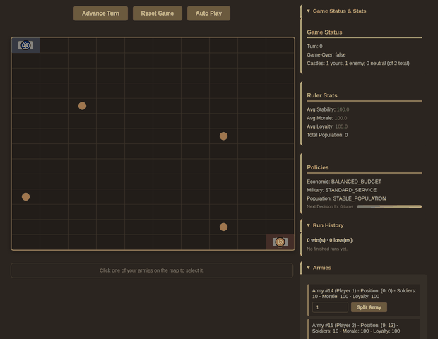
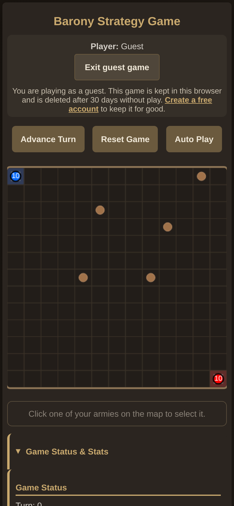
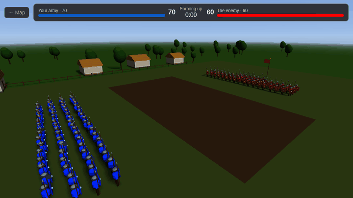
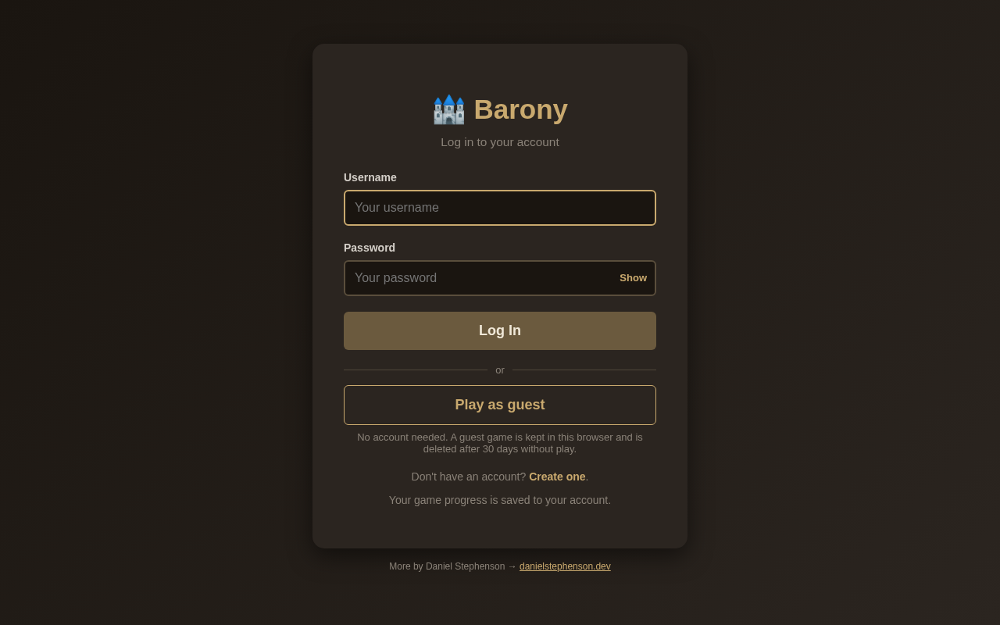
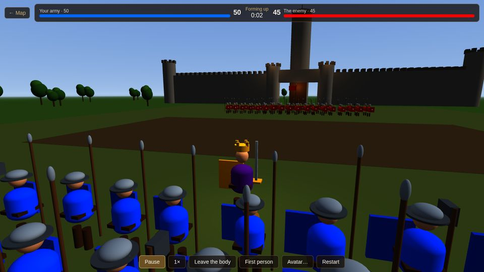
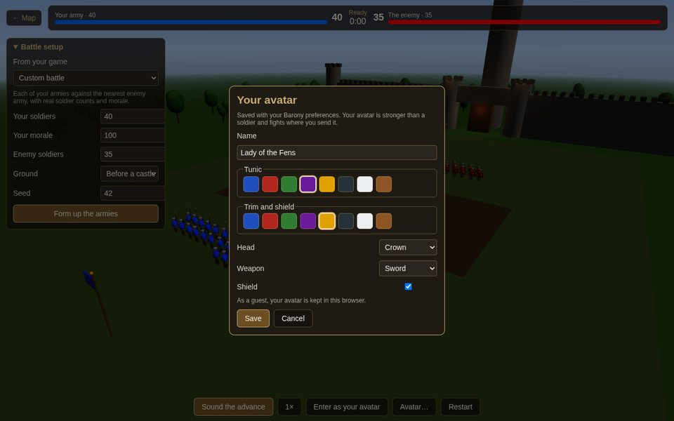
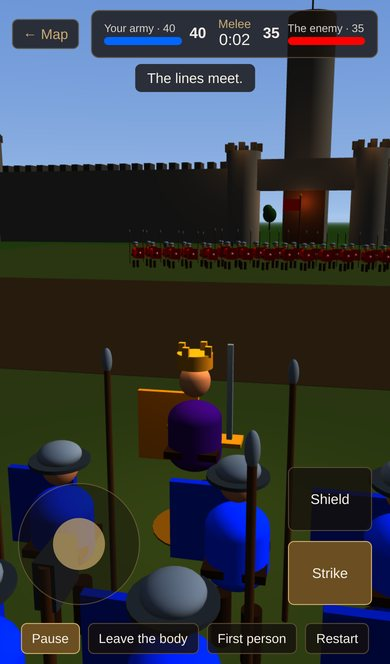
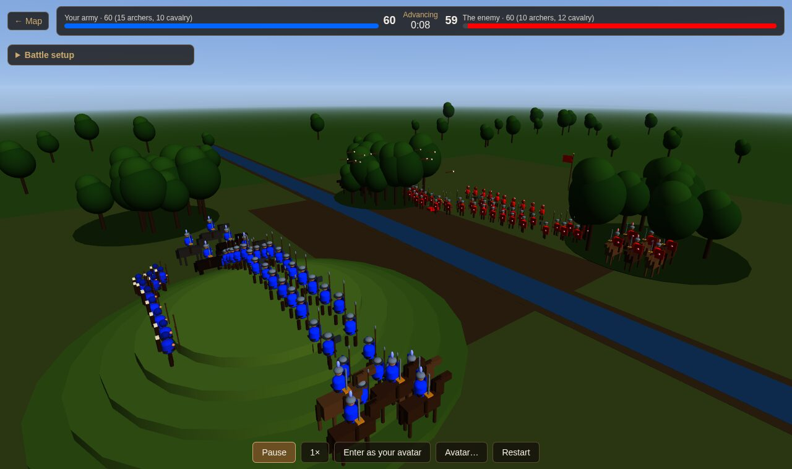
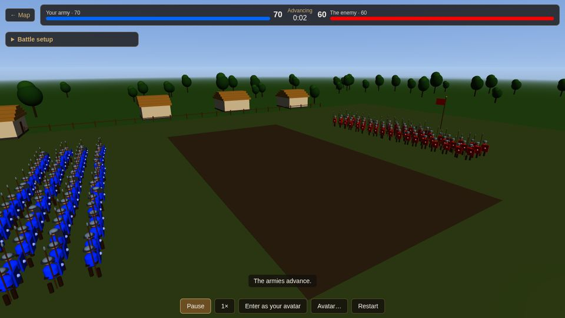

# Barony

**Version:** 2.0.0-SNAPSHOT-8-8-2026  
**A single-player online strategy game with army movement, territory control, and AI opponent**

Barony is a browser-based turn-based strategy game where you command armies to capture villages and castles against an AI opponent. Build your forces, control territory, and use strategic policies to defeat your enemy.

<p align="center">
  
  
</p>
<p align="center"><em>A guest game in the web client: one move order, then Auto Play; and the same page at phone width.</em></p>

<p align="center">
  
</p>
<p align="center"><em>When armies meet, the battle is fought out in 3D, one figure per soldier, and the result decides the map (see <a href="#3d-battlefield">3D Battlefield</a>).</em></p>

<p align="center">
  
</p>

<sub>How these were captured: the backend and web client jars were built and run locally (in-memory H2, usage reporting off), a guest game was started with "Play as guest", and the page was driven and screenshotted with headless Chromium (Playwright) on 2026-10-18. Each guest game gets its own random map.</sub>

## Documentation

### Quick Links
- **[PLAYER_GUIDE.md](PLAYER_GUIDE.md)** - Complete guide to playing Barony (start here!)
- **[DOCS.md](DOCS.md)** - Documentation index (find what you need)
- **[CHANGELOG.md](CHANGELOG.md)** - Version history and features

### For Developers
- **[MVP.md](MVP.md)** - MVP specification and implementation details
- **[ROADMAP.md](ROADMAP.md)** - Future feature roadmap (v1.1+)
- **[TICKETS.md](TICKETS.md)** - Development tickets and tasks

## Quick Start

### Using Docker (Recommended)

Barony authenticates players through the standalone [**UserAuth**](https://github.com/Preponderous-Software/UserAuth)
service, which `docker-compose` builds from a sibling checkout. Clone it next to this repo first:

```bash
# from the directory that contains barony/
git clone https://github.com/Preponderous-Software/UserAuth.git
cd barony
# JWT_SECRET must be at least 32 bytes; override the dev default in production
export JWT_SECRET="please-change-this-to-a-32-byte-minimum-secret"
docker-compose up --build
```

This brings up four services together: `userauth-db` (Postgres), `userauth` (port 9998),
`backend` (8080), and `web-client` (3000). Then open http://localhost:3000 in your browser,
create an account, and log in.

> If UserAuth lives elsewhere, point `USERAUTH_PATH` at it (e.g. `USERAUTH_PATH=../sibling/UserAuth`).

### Manual Start

Accounts also need UserAuth running on port 9998 (see its README).

```bash
# Backend
cd backend && ./mvnw spring-boot:run

# Web Client (separate terminal)
cd web-client && ./mvnw spring-boot:run
```
Then open http://localhost:3000 in your browser.

## Project Structure

- `backend/` - Spring Boot REST API (game logic)
- `web-client/` - Browser-based client (HTML5 Canvas)

## Backend API

### REST Endpoints

**Single-Game Endpoints:**
- `GET /state` - Get current game state
- `POST /tick` - Advance game by one turn
- `POST /command` - Send a MOVE, SPLIT or TRAIN command (see [Commands](#commands))
- `POST /api/reset` - Reset game
- `POST /api/decision` - Change ruler policy
- `GET /api/ruler-stats` - Get realm statistics

**Authenticated, Per-Player Endpoints (require the `barony_token` auth cookie, or an `Authorization: Bearer <token>` header):**
- `GET /api/session/state` - Get the authenticated player's game state
- `POST /api/session/tick` - Advance the player's game by one turn
- `POST /api/session/command` - Send a command for the player
- `POST /api/session/reset` - Reset the player's game
- `POST /api/session/decision` - Change ruler policy for the player
- `GET /api/session/ruler-stats` - Get realm statistics for the player
- `GET /api/session/runs` - Get the player's win/loss tally and recent finished-run history
- `GET /api/session/preferences` - Get the player's stored interface preferences (`{}` when none are stored)
- `PUT /api/session/preferences` - Replace the player's stored interface preferences (JSON object, up to 8192 characters serialized; larger is rejected with `400`)
- `POST /api/session/battle` - Resolve one of the paused turn's pending battles, with a fought result or by the map's rule (body format under [3D Battlefield](#3d-battlefield))
- `POST /api/session/field-battles` - Turn field battles on or off for the player's game (body format under [3D Battlefield](#3d-battlefield))
- `POST /api/session/start-fresh` - Start a fresh game after the player's saved game could not be read (see below); the unreadable save is copied first, to `saved_game_backup` for an account or `guest_game_backup` for a guest. Returns a readable game unchanged, so repeating it is safe

**A saved game that cannot be read is never replaced.** If an account's or a guest's stored game
exists but cannot be read, it is left untouched in the database and logged (the username, or the
first 8 characters of the guest key, and the parse error with its position, never the save itself),
and every endpoint above that needs the game answers `409` with
`{"error": "unreadable-save", "message": "...", "status": 409}` instead of making a fresh game. For a
guest, `POST /api/guest` (resume) and `POST /api/guest/claim` answer the same `409`: resuming does
not create a new guest in its place, and the unreadable game is neither copied into the account nor
deleted. The game page shows that message with a **Start a fresh game** button, which asks for
confirmation and then calls `POST /api/session/start-fresh`. A guest claim (`POST /api/guest/claim`)
into an account whose save is unreadable is refused with `409`, as for any account that already has
a game.

These endpoints validate the token against UserAuth on every request, so a missing, invalid,
expired, or revoked (logged-out) token that cannot be renewed is rejected with `401`. When the
`barony_token` cookie is missing or within 30 seconds of expiring and a `barony_refresh` cookie is
present, the session is renewed first and both cookies are set again on the response; a rejected
refresh token clears that cookie and the request gets the usual `401`. If UserAuth cannot be
reached, the request gets `503` and the cookies stay, so an outage does not sign the player out.
Game state is keyed by the authenticated username.

**Guest play (no account):**
- `POST /api/guest` - Start a guest game, or resume this browser's one. Sets an **HttpOnly** `barony_guest` cookie holding a random server-issued token (a different cookie from `barony_token`). New guests are rate limited per client address and globally (`429`), and capped in total (`503`).
- `POST /api/guest/claim` - "Keep your progress": with both a valid account cookie and a guest cookie, move the guest game (and its finished runs) into the account, **only if the account has no game yet** (`409` otherwise; nothing is changed). A missing or invalid account cookie gets `401`, and a browser with no guest game gets `404`.

A guest plays through the same `/api/session/*` endpoints using the guest cookie (except preferences, which answer `403` for guests and stay in the browser). Guest games live only in the `guest_game` table, keyed by the SHA-256 of the cookie token, and are never written to the account tables; an unreadable guest game set aside by a fresh start goes to `guest_game_backup` under that same key, never the token. Guests idle for 30 days (`guest.idle-days`) are deleted by a scheduled prune that touches only `guest_game`. Pages send `X-Barony-Player: account|guest`, so an account page whose login has lapsed is sent to log in instead of being served a guest game.

**Authentication (proxied to the [UserAuth](https://github.com/Preponderous-Software/UserAuth) service):**
- `POST /api/auth/register` - Create an account (`{username, password}`); answers `201` with the created user's public fields
- `POST /api/auth/login` - Log in; sets the JWT in an **HttpOnly** `barony_token` cookie and the refresh token in an **HttpOnly** `barony_refresh` cookie, which renews the session on per-player requests (returns `{username, expiresAt}`, never the token)
- `POST /api/auth/logout` - Revoke the session and clear both cookies (returns `{"message": "logged out"}`)

A missing username or password gets `400`. UserAuth's own `4xx` answers (such as `401` for bad
credentials) are passed through, and if UserAuth cannot be reached these endpoints answer `503`. A
failed logout leaves the cookies in place.

#### Authentication flow

Barony never stores credentials itself — it delegates to UserAuth. On login the UserAuth-issued
JWT and refresh token are placed in **HttpOnly, SameSite=Lax cookies** rather than handed to
JavaScript, so an XSS can't read them; the browser then sends them automatically and the backend
validates the JWT on each authenticated game request. (A `Bearer` header is still accepted as a
fallback for CLI / API clients that already hold a token.)

The refresh token is single-use: each renewal replaces it, and the session lasts until UserAuth
stops accepting the latest one.

Two backend settings shape the cookies, neither of them set in `docker-compose.yml`:

- `AUTH_COOKIE_SECURE` - adds `Secure` to the account and guest cookies. It defaults to `false` for
  local HTTP; set it to `true` in production over HTTPS.
- `AUTH_REFRESH_COOKIE_DAYS` - how long the browser keeps the refresh cookie (default `30`). Keep
  it in step with UserAuth's `REFRESH_TOKEN_EXPIRATION_DAYS`, which decides when the token stops
  working.

```
browser → web-client (proxy) → backend → UserAuth (/register, /login, /token/refresh, /session/validate, /logout)
```

```bash
# Register
curl -X POST http://localhost:8080/api/auth/register \
  -H "Content-Type: application/json" \
  -d '{"username":"alice","password":"a-strong-password"}'

# Log in — the JWT and refresh token are set as HttpOnly cookies (saved to the jar), not returned in the body
curl -c cookies.txt -X POST http://localhost:8080/api/auth/login \
  -H "Content-Type: application/json" \
  -d '{"username":"alice","password":"a-strong-password"}'

# Use the cookie on per-player endpoints
curl -b cookies.txt http://localhost:8080/api/session/state

# Log out (revokes the session and clears both cookies; the token is refused afterward)
curl -b cookies.txt -X POST http://localhost:8080/api/auth/logout
```

### Command Examples

**Move Army:**
```bash
curl -X POST http://localhost:8080/command \
  -H "Content-Type: application/json" \
  -d '{"type":"MOVE","armyId":1,"targetX":5,"targetY":5}'
```

**Split Army:**
```bash
curl -X POST http://localhost:8080/command \
  -H "Content-Type: application/json" \
  -d '{"type":"SPLIT","armyId":1,"splitAmount":5}'
```

**Train Army** (archers at a village you hold, cavalry at a castle you hold):
```bash
curl -X POST http://localhost:8080/command \
  -H "Content-Type: application/json" \
  -d '{"type":"TRAIN","armyId":1,"unitType":"CAVALRY","count":3}'
```

Commands act only on player 1's armies; a `MOVE` or `SPLIT` naming one of the AI's armies is
ignored, and a `TRAIN` naming one is refused with `400`. See [Commands](#commands) for every field
and error.

**Change Policy:**
```bash
curl -X POST http://localhost:8080/api/decision \
  -H "Content-Type: application/json" \
  -d '{"category":"ECONOMIC","choice":"HEAVY_TAXATION"}'
```

`category` is `ECONOMIC`, `MILITARY` or `POPULATION`; `choice` must name a policy in that category
(`HEAVY_TAXATION`, `BALANCED_BUDGET`, `INFRASTRUCTURE_INVESTMENT` / `AGGRESSIVE_TRAINING`,
`STANDARD_SERVICE`, `VETERAN_BENEFITS` / `GROWTH_FOCUS`, `STABLE_POPULATION`,
`QUALITY_OVER_QUANTITY`). A missing field or a choice from the wrong category is rejected with
`400`. One 15-turn cooldown covers all three categories; a change made before it has run out is
rejected with `409`. The cooldown is checked before the choice, so a wrong choice sent during
the cooldown also gets `409`. The same rules apply to
`POST /api/session/decision`.

**Demo script:** with the backend running, `./demo-api.sh` plays a short game through the
single-game endpoints: it starts a new game (replacing the current single game), marches player 1's
army to the nearest village, and prints the capture and the soldiers it recruits. It needs `curl`
and `python3`, and `BASE_URL` points it at a backend other than `http://localhost:8080`.

### Response Structure

`GET /state`, `POST /tick`, `POST /command`, `POST /api/reset`, `POST /api/decision` and their
`/api/session/*` counterparts, as well as `POST /api/session/battle` and
`POST /api/session/field-battles`, all return the game state as JSON:

- `grid` - tiles indexed `grid[x][y]`, each with `type` (`CASTLE`, `VILLAGE` or `EMPTY`), `ownerId`
  (`0` neutral, `1` player, `2` AI), `occupationTicks`, `stability` and `population`
- `width`, `height` - the map size
- `armies` - each with `id`, `x`, `y`, `soldiers`, `playerId`, `destinationX`, `destinationY` (`null`
  with no order), `moving`, `morale`, `loyalty` and `desertionCarryBasisPoints`; and the unit mix:
  `archers` and `cavalry` (part of `soldiers`, `0` in saves from before unit types), `infantry` (the
  rest, read-only), `trainingType` (`ARCHERS`, `CAVALRY` or `null`), `trainingRemaining` and
  `training`
- `tickCount`, `gameOver`, `winnerId` (`null` until the game ends), `aiEnabled`
- `economicPolicy`, `militaryPolicy`, `populationPolicy`, `lastPolicyChangeTick`
- `runRecorded` - internal bookkeeping for run history, always `false` here
- `pendingBattles` - the battles waiting to be fought this turn (empty when none), each with `id`,
  `x`, `y`, `terrain` (the tile type), `seed`, `tick`, `side0ArmyIds` and `side1ArmyIds` (side 0 is
  always player 1, side 1 the AI), `side0Soldiers`, `side1Soldiers`, `side0Archers`,
  `side0Cavalry`, `side1Archers`, `side1Cavalry` (each side's archers and cavalry, summed over its
  armies; the rest are infantry) and `side0Morale` (player 1's morale on the tile, weighted by
  soldiers)
- `nextBattleId` - the battle-id counter: the id of the latest pending battle this game (`0` before
  the first); the next one gets one more
- `unitTypes` - `true` in games started since unit types, where the AI trains archers and cavalry
  too; `null` in older saves, whose AI plays exactly as before
- `fieldBattles` - whether engagements pause the turn for a field battle: `true`, `false`, or `null`
  when never set. The engine treats `null` as off (so the single-game endpoints and old saves keep the
  classic rule), and a player's session turns it on while it is still `null`

With field battles on, `POST /api/session/tick` can return with `pendingBattles` non-empty: the turn
has paused before combat. It finishes (captures, the win check, desertion and respawns) once the last
pending battle is resolved through `POST /api/session/battle`.

### Commands

`POST /command` and `POST /api/session/command` take one command for one of player 1's armies:

- `{"type": "MOVE", "armyId", "targetX", "targetY"}`
- `{"type": "SPLIT", "armyId", "splitAmount"}` - the new army takes its share of each unit type in
  proportion; add `"splitArchers"` and `"splitCavalry"` to choose exactly how many of each it takes
  (the rest of `splitAmount` is infantry)
- `{"type": "TRAIN", "armyId", "unitType": "ARCHERS" | "CAVALRY", "count"}` - convert `count` of the
  army's infantry, one for one: archers at a village the player holds (2 a turn), cavalry at a castle
  the player holds (1 a turn). The army must be standing on that tile with no move order. A new order
  replaces the current one, `count: 0` stops training, and the order is dropped if the army marches
  off, loses the tile or runs out of infantry. Refused with `400` for an unknown army or unit type or
  a `count` below 0 or above its infantry, and `409` when the army is not on such a tile, is marching,
  or is in a pending battle.

`GET /api/ruler-stats` and `GET /api/session/ruler-stats` return `averageStability`,
`averageMorale`, `averageLoyalty`, `totalPopulation`, `economicPolicy`, `militaryPolicy`,
`populationPolicy` and `ticksUntilNextDecision`.


## Web Client

Browser-based interface with HTML5 Canvas rendering.

**Start:** 
```bash
docker-compose up
```
Then open http://localhost:3000

### Features
- Toast notifications replace all in-game blocking alerts
- Canvas hover tooltips (tile info, army stats, castle capture progress)
- Army selection highlight ring on canvas
- Destination markers for your moving armies, and capture progress bars on contested castles
- Right-click to deselect armies
- Auto Play toggle button (single button, active-state indication)
- Color-coded stats (green ≥ 90, amber 70–89, red < 70)
- Policy cooldown progress bar
- Game-over banner overlay on canvas, with a run summary (turns, castles/villages held, armies and
  soldiers remaining)
- Inline split validation (no alerts)
- Unit types: each army's mix of infantry, archers and cavalry in its panel and tooltip, small marks
  on the map for archers and cavalry, and a Train control on villages and castles you hold
- Colorblind modes: Deuteranopia, Protanopia, Tritanopia
- Themes: Dark (default), Classic, High Contrast
- Adjustable font size: Small, Medium, Large
- Settings panel with live preview
- Settings persisted to `localStorage` under `barony_settings`
- Arrangeable sidebar: panels can be shown/hidden and reordered from the Settings panel, and the
  arrangement is persisted to `localStorage` under `barony_panel_layout` (open/closed state under
  `barony_panel_state`)
- Preferences follow the account: for a signed-in player the settings and sidebar arrangement are
  also stored against their account (`/api/session/preferences`) and applied on any browser or
  device they sign in from. `localStorage` remains the working copy, so an unreachable backend
  costs nothing beyond the arrangement not travelling
- Keyboard shortcuts: `Space` advance turn, `R` reset, `S` focus split amount, `A` toggle Auto Play, `Escape` deselect
- Castle objective progress (yours / enemy / neutral, out of the map total) in the Game Status panel
- Milestone toasts when a castle changes hands or the last castle on either side comes under siege

## 3D Battlefield

Any engagement can be fought out as a 3D field battle at `/battle`, drawn by the
[Strata](https://github.com/Preponderous-Software/strata) engine in WebGL 2. Select one of your
armies on the map and choose **Practice in 3D** to load it and the nearest enemy army, with their
real soldier counts, morale and ground (open field, village or castle), as a practice battle. While
that army is in a battle waiting this turn, the same link reads **Fight it in 3D** and opens that
battle instead. You can also set up a custom battle without signing in.



<p align="center">
  
  
</p>
<p align="center"><em>The avatar editor, and fighting as the avatar on a phone (stick to move, drag to look, Strike and Shield).</em></p>

- **The lie of the land**: every map tile has its own battlefield ground, the same each time: woods on the flanks,
  perhaps a rise on one side's half, perhaps a stream between the lines, with the tile's neighbouring villages and
  castles beyond the field's edges. Woods slow horses and stop arrows; a side with a rise in its half holds it and
  strikes harder downhill; a stream slows anyone wading it. The map's own rule ignores the ground.

  
- **Watch** from an orbit camera at ½×, 1×, 2× or 4× speed, with a live tally of soldiers standing and running.
- **Take over any soldier** by tapping or clicking it. You get a third-person view, and **V** switches to first person.
  Move with WASD and the mouse (click to lock the mouse), strike with a click or Space, and raise your shield
  with the right button or F. On a phone you get a stick plus Strike and Shield buttons. If your soldier falls,
  you can take over another.
- **Enter as your own avatar**: name, tunic and trim colours, helmet, weapon and shield. Your avatar is
  stronger than a soldier and is saved with your account preferences (a guest's stays in the browser).
  The avatar cannot hold the field alone: only soldiers decide who holds the field, so once all of a
  side's soldiers have fallen or fled that side has lost, even if the avatar still stands.



One figure stands for each soldier up to 90 a side. Above that, both armies share one scale, so a
larger army keeps its edge in numbers. Morale decides how hard a side hits and how long it holds
before it breaks and runs.


**Battles decide the map.** When a turn brings your armies onto the same tile as the enemy, the turn
pauses before combat and the game takes you to that battle (`/battle?pending=<id>`). That battle is
locked to the real armies, ground and seed. When it ends, the result is sent back to the game. The
winner keeps the soldiers still standing. The loser keeps only those who got away and falls back to
a neighbouring tile: only onto open ground or its own villages and castles, never onto an enemy or
neutral village or castle, or a tile held by an enemy army. With nowhere allowed to go, it is lost.
Then the rest of the turn runs: captures, the win check, desertion and respawns. You can instead **Let the map decide**, which applies
the classic rule that both sides lose the other's strength in one exchange. Turning off **Fight battles
in 3D** in Settings makes every battle resolve that way at once. Ending the turn while a battle waits
also lets the map decide it. Battles you set up yourself at `/battle` are practice and change
nothing.

The browser reports a fought battle's result, and the backend refuses any result in which a side
keeps more soldiers than it started with or the winner has nobody left, or (when the result gives
them by type) more archers, cavalry or infantry than it brought. Barony is single-player
against the AI, so a forged result only affects your own game and run history.

API: `POST /api/session/battle` takes `{"battleId", "result": "FIELD", "winner": 0|1|null,
"survivors": [yours, theirs]}` or `{"battleId", "result": "AUTO"}`. A fought result may add
`"survivorsByType": [[infantry, archers, cavalry], [infantry, archers, cavalry]]` (yours, then
theirs; each side's three must add up to its `survivors`), and each type's survivors are then shared
among that side's armies by how many of that type each brought. Without it, each army's losses come
out of its unit types in proportion. `POST /api/session/field-battles`
takes `{"enabled": true|false}`. Pending battles appear in the game state as `pendingBattles`.

The engine is a thin C++ host (`web-client/battle3d/main.cpp`) built with Emscripten 6.0.11
against Strata's pinned v0.7.0 wasm release (`web-client/battle3d/build.sh`). The outputs are
committed so the Maven build needs no Emscripten. CI rebuilds them and fails if the bytes differ.
The battle itself is plain JavaScript (`battle-sim.js`, `battle-render.js`, `battle-avatar.js`) and is
tested under Node in `web-client/src/test/js/battle-sim.test.js`.

## Game Overview

### Basic Rules
1. **Goal:** Capture all enemy castles to win
2. **Players:** You (blue) vs AI (red)
3. **Movement:** Armies move 1 tile per turn
4. **Villages:** Generate soldiers each turn for their owner's army stationed there — one per 100 population (1 at the start, more as your villages grow)
5. **Combat:** Battles are fought on the [3D battlefield](#3d-battlefield) by default; a battle left
   to the map is settled by simultaneous damage (10 vs 7 → 3 vs 0)
6. **Castle Capture:** Occupy for 3 consecutive turns
7. **Unit types:** Train infantry into archers at your villages or cavalry at your castles; in a
   battle left to the map an archer counts as 1.25 soldiers and a horseman as 1.5

See [PLAYER_GUIDE.md](PLAYER_GUIDE.md) for complete gameplay instructions.

## Development

**Requirements:** Java 17, Maven (wrapper included). Node.js 18+ if you also want to run the game
page's JS tests locally (`node --test web-client/src/test/js/`).

### Build & Test
```bash
# Backend
cd backend && ./mvnw clean package test

# Web Client
cd web-client && ./mvnw clean package test

# Web Client game page logic (pure JS, no build step needed)
node --test web-client/src/test/js/
```

### CI/CD
GitHub Actions runs on all PRs:
- Builds backend and web client
- Runs all unit and integration tests
- Runs the game page's JS test suite (`web-client/src/test/js/`) with Node
- Uses JDK 17 with Maven caching

## Technical Architecture

### Backend
- Spring Boot REST API
- Per-player game state, kept in memory and **persisted per account** so games survive restarts.
  A stored game that can't be read is kept as it is, never overwritten; it is copied unchanged to the
  insert-only `saved_game_backup` table (`guest_game_backup` for a guest) only when the player
  confirms a fresh start
- Storage: embedded **H2** saved to `./data` by default (mount it as a volume in production); set `DB_URL` (+ `DB_USERNAME`/`DB_PASSWORD`) to use Postgres instead
- Unique army IDs (not list indices)
- CORS: localhost only
- **Usage reporting:** once the backend is ready it sends a single `startup` event to the
  [trace](https://danielstephenson.dev/usage-reporting) usage service at
  `https://trace.danielstephenson.dev`, carrying only the program name (`barony`), the backend
  version and the tag `service=true` — nothing per request, and nothing about players, accounts,
  saved games or the host. The send happens on its own daemon thread, never throws and never
  blocks startup; an unreachable trace server is a dropped report, not an error. Settings live in
  `backend/src/main/resources/application.properties` under `usage-reporting.*` (`enabled`,
  `endpoint`, `key`), each with an environment-variable override — set
  `USAGE_REPORTING_ENABLED=false` to turn it off. Tests always run with it off. Every opt-out is
  listed under [Usage reporting](#usage-reporting).

### Web Client
- Spring Boot + Thymeleaf
- HTML5 Canvas rendering
- RESTful backend communication
- Pages are served from the web client's own origin, so every `/api/*` call they make is answered
  by the web client and proxied to the backend with the auth cookie forwarded — a backend endpoint
  a page calls needs a matching proxy route here (guarded by `ProxyRouteCoverageTest`)
- **Usage reporting → page views:** the web client reports to the same
  [trace](https://danielstephenson.dev/usage-reporting) service, under the same program name and
  key as the backend: one `startup` event when it is ready (version, `service=true`), and then one
  `page-view` event per HTML page it serves. A page view records the **request path only**
  (`/login`, `/register`, `/game` — no query string, capped at 200 characters) plus the version;
  it never records an IP address, user agent, cookie, session, account or referrer, so the result
  is a count of page loads, not of visitors. API calls, static assets, redirects, error pages and
  requests from crawlers, monitors and scripted clients are not counted. Reports are sent off the
  request thread and never slow a page. Settings live in
  `web-client/src/main/resources/application.yml` under `usage-reporting.*` (`enabled`,
  `endpoint`, `key`), each with an environment-variable override — set
  `USAGE_REPORTING_ENABLED=false` on the web client to turn page views and its startup event off
  together. Tests always run with it off. Every opt-out is listed under
  [Usage reporting](#usage-reporting).

## Troubleshooting

### Common Issues

**Backend won't start:**
- Check Java 17: `java -version`
- Port 8080 in use: `lsof -i :8080` (Unix) or `netstat -ano | findstr :8080` (Windows)

**Web client won't load:**
- Ensure backend is running first
- Check that port 3000 isn't already in use
- Try clearing browser cache

**Policy changes not working:**
- Wait for 15-turn cooldown
- Check the **Next Decision In** bar in the Game Status & Stats panel for the timer
- Effects are gradual (several turns)

For detailed troubleshooting, see [PLAYER_GUIDE.md](PLAYER_GUIDE.md).

## Getting Help

- **Playing the game?** See [PLAYER_GUIDE.md](PLAYER_GUIDE.md)
- **Technical issues?** Check the Troubleshooting section above
- **Can't find what you need?** See [DOCS.md](DOCS.md) for documentation index
- **Found a bug?** Open an issue on GitHub

## Usage reporting

Usage reporting is on by default: the backend and the web client each send one `startup` event
(program name `barony`, version, tag `service=true`) to the trace service at
`https://trace.danielstephenson.dev` when they are ready, and the web client sends one
`page-view` event per HTML page it serves (request path and version only). Nothing about
players, accounts, saved games, visitors (no IP address, user agent, cookie, session or
referrer) or the host is sent, and nothing per API call.

Every event also carries a random installation ID as the tag `install`, so the number of
running deployments can be counted rather than events. It is the value of `TRACE_INSTALL_ID`
when that is set (to pin one ID per deployment), and otherwise a random UUID written the first
time reporting runs to `<user data dir>/barony/trace-install-id` (`$XDG_DATA_HOME` or
`~/.local/share` on Linux, `~/Library/Application Support` on macOS, `%APPDATA%` on Windows)
and reused after that. In a container that directory is usually not on a volume, so a recreated
container counts as a new installation unless `TRACE_INSTALL_ID` is set. The ID identifies no
person, account, host or address; delete the file to get a new one. Every opt-out also stops
it: when reporting is off, no ID is made up and the file is neither read nor written. The
backend and the web client each keep their own file when they run as different users or
containers, and share one when they run as the same user on one machine.

Turn it off any of these ways (the backend and the web client are separate processes, so
apply it to each one that should stop):

- `USAGE_REPORTING_ENABLED=false` in the process's environment (`usage-reporting.enabled` in
  `backend/src/main/resources/application.properties` and
  `web-client/src/main/resources/application.yml`)
- `TRACE_USAGE_REPORTING=off` in the environment (also `false`, `0`, `no`; shared by every
  program that reports to trace, and it wins over the setting above)
- `DO_NOT_TRACK=1` in the environment (also `true`, `yes`; see
  [consoledonottrack.com](https://consoledonottrack.com))

Each process logs one line at startup saying whether reporting is on and, if it is off, which
switch turned it off. Details: https://danielstephenson.dev/usage-reporting

## License
This project is licensed under the **Stephenson Software Non-Commercial License (Stephenson-NC)**.  
© 2025 Daniel McCoy Stephenson. All rights reserved.

You may use, modify, and share this software for **non-commercial purposes only**.  
Commercial use is prohibited without explicit written permission from the copyright holder.

Full license text: [LICENSE.md](LICENSE.md) (canonical: [Stephenson-Software/stephenson-nc-license](https://github.com/Stephenson-Software/stephenson-nc-license))  
SPDX Identifier (custom): `LicenseRef-Stephenson-NC`